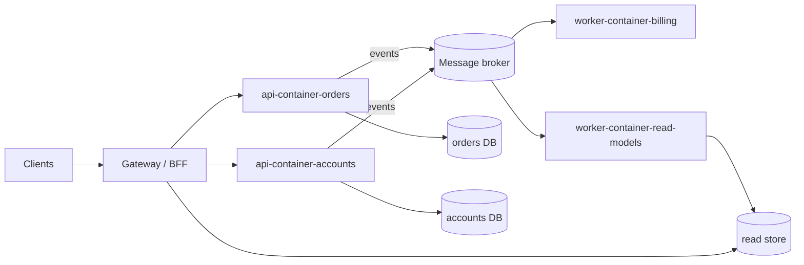

> **Gate:** this archetype is the deliberate exception to the architect skill's "never recommend
> microservices for an early-stage product." SELECT must not recommend it unless **two or more
> platform-layout split triggers have actually fired** (own deploy lifecycle, dedicated team,
> different stack, CI drag) or the product starts with proven scale and a multi-team org.

## Topology

Each domain is a containerized service owning its database. Business facts are published to the
broker; cross-domain reactions and materialized read models are consumers. Reads that span
domains hit read models, not other services' databases.

## Stack rationale

- **Containers, not functions** — at sustained throughput, always-on containers are cheaper and
  more predictable than Lambda, and teams get full runtime control.
- **Database per service** — the isolation that makes independent deploys real; shared databases
  recreate the monolith with network latency added.
- **Events between services, sync only at the edge** — synchronous service-to-service call chains
  are the classic distributed-monolith trap.
- **CQRS-lite** — materialized read models only where cross-domain reads or read/write scaling
  actually diverge; not event-sourcing-everything.
- **TypeScript default, polyglot by exception** — language sprawl is an ops tax; a service earns
  a different runtime with a written reason (an ADR).

## platform/ mapping

- `services/api-container-{domain}` / `services/worker-container-{domain}` — one deployable per
  domain; handlers and business rules inside each.
- `core/contracts` — **event and API schemas are the system's constitution**: every cross-service
  message type lives here, versioned additively.
- `core/server` — service chassis: http wrapper, env, observability, health checks.
- `core/adapters` — shared capabilities behind interfaces (email, payments, storage).
- `data` — per-service migration tooling; `infra` — IaC per service + shared network; `ops` — CI
  templates, preflight scripts (CODEOWNERS-restricted).

## ADR seeds

### microservices-justified-by-split-triggers

**Status:** Proposed

**Context:** Microservices cost coordination, infrastructure, and debugging complexity; that cost
must be bought by real, present needs — not anticipated ones.

**Decision:** Adopt (or migrate to) per-domain services only because ≥2 split triggers have fired
or the org is already multi-team at scale. Record which triggers, here, at apply time.

**Alternatives Considered:**
1. Stay/start monolith — rejected **only if** the trigger evidence above is real; otherwise this whole archetype is the wrong choice.
2. SOA with a shared database — rejected: couples every service through the schema; worst of both worlds.

**Consequences:**
- Positive: independent deploys and scaling per team/domain.
- Negative: distributed tracing, contract management, and environment cost become permanent line items.
- Risks: premature adoption — re-check the trigger evidence before accepting this ADR.

### database-per-service

**Status:** Proposed

**Context:** Independent deployability dies when services share tables; schema changes would need
cross-team lockstep.

**Decision:** Each service owns its database exclusively. Other services get data via events
(materialized into read models) or that service's API — never via its tables.

**Alternatives Considered:**
1. Shared database — rejected: schema coupling reintroduces lockstep releases.
2. Shared DB with schema-per-service — rejected: half-isolation that still tempts cross-schema joins.

**Consequences:**
- Positive: schema autonomy; blast-radius containment; per-domain backup/scale policies.
- Negative: no cross-service joins or transactions — sagas and eventual consistency instead.
- Risks: data duplication across read models; reconciliation jobs needed.

### cqrs-lite-read-models

**Status:** Proposed

**Context:** Cross-domain reads (dashboards, search, lists) would otherwise fan out across
services or sneak into direct DB access.

**Decision:** Materialize read models from domain events for cross-domain or read-heavy views; a
dedicated consumer owns each read store. Write paths stay simple CRUD within their service —
no event sourcing as the system of record.

**Alternatives Considered:**
1. API composition at the gateway — acceptable for small fan-out; rejected as the general answer (latency + partial-failure amplification).
2. Full event sourcing — rejected: replay/versioning complexity not bought by current requirements.

**Consequences:**
- Positive: fast reads, no cross-service query coupling, natural audit trail from events.
- Negative: read models lag writes (eventual consistency surfaces in UX); rebuild tooling required.
- Risks: silent divergence — mitigated by periodic reconciliation against owning services.

## Trade-offs accepted

- A platform team's worth of operational surface: broker, tracing, per-service CI/CD, env sprawl.
- Eventual consistency as a product-design constraint, not an edge case.
- Higher fixed cost floor (every service runs ≥2 replicas + the broker).

## Scale-out / exit path

If team size drops or domains stabilize, consolidation is legitimate: merge low-traffic services
back into a modular monolith per domain; the `core/contracts` schemas make either direction cheap.

## Reference deployment

- **Envs:** `staging` + `production` clusters; ephemeral preview only at the gateway/BFF layer.
- **CI:** per-service pipelines from shared templates in `ops/`; contract tests on
  `core/contracts` gate producer deploys; canary or blue/green per service.
- **Cost ballpark:** $500–2000+/mo floor (cluster, broker, observability) before traffic.

## Confirm per product

- [ ] Evidence: which ≥2 split triggers have fired? (record in the first ADR)
- [ ] Domain boundaries — run an event-storming/context-mapping session before cutting services
- [ ] Broker choice: NATS JetStream / RabbitMQ vs Kafka (volume, retention, team experience)
- [ ] ECS/Fargate vs Kubernetes (existing estate, hiring pool)
- [ ] Observability stack + tracing standard (OpenTelemetry collector, vendor)
- [ ] Identity provider and service-to-service auth scheme
