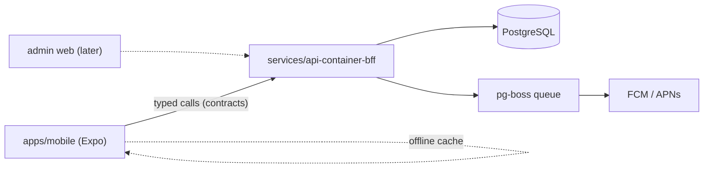

## Topology

The mobile app talks only to its BFF — an API shaped for the app's screens, not a generic
resource API. Shared types in `core/contracts` keep app and BFF in lockstep. Push goes through a
queue so notification fan-out never blocks a request.

## Stack rationale

- **Expo** — one React/TypeScript codebase for iOS + Android, over-the-air JS updates for fixes
  between store releases, EAS handles signing/build pain. Eject paths exist if a native module
  demands it.
- **A BFF, not a generic API** — mobile clients live for years on users' devices; an API shaped
  exactly to the screens minimizes payloads and round-trips, and versioning happens where the
  client is known.
- **Shared `core/contracts`** — the request/response schemas the app and BFF both import; drift
  between a shipped app and the server is the #1 mobile failure mode.
- **Token auth** — sessions don't fit app lifecycles; short-lived access + refresh tokens in
  secure storage do.
- **Queue-backed push** — fan-out is bursty and retryable; platform tokens go stale and need
  cleanup jobs.

## platform/ mapping

- `apps/mobile` — the Expo app: screens, navigation, offline cache, feature components.
- `services/api-container-bff` — the BFF (its routers/handlers live inside it, per
  platform-layout); named `{compute}-{tech}-{name}`.
- `core/contracts` — endpoint schemas, shared domain types, push payload types.
- `core/adapters` — push provider behind an interface (FCM/APNs impls swappable; mock in tests).
- `data` — Prisma schema + migrations.

## ADR seeds

### expo-react-native

**Status:** Proposed

**Context:** Mobile-first product; the team is TypeScript-native; two separate native codebases
would halve velocity.

**Decision:** Expo (React Native) for the app, with EAS for builds and submissions, and
over-the-air updates for JS-level fixes.

**Alternatives Considered:**
1. Native Swift + Kotlin — rejected: 2× codebases and skill sets for no current native-only requirement.
2. Flutter — rejected: Dart splits the stack; TypeScript sharing with the BFF is worth more.
3. PWA — rejected: push/offline/store-presence requirements exceed reliable PWA support.

**Consequences:**
- Positive: one codebase, shared language with the backend, OTA fixes between releases.
- Negative: native-module needs are gated by the Expo ecosystem; store review still applies to native changes.
- Risks: a hard native requirement later forces a config-plugin/eject detour.

### bff-owns-api-shape

**Status:** Proposed

**Context:** Shipped app versions can't be force-upgraded; the API contract must be stable and
client-shaped.

**Decision:** One BFF service owns the API surface, shaped per-screen, versioned additively;
breaking changes require a new versioned route and a deprecation window measured in app-store
adoption, not deploy cycles.

**Alternatives Considered:**
1. Generic REST resource API — rejected: chatty for mobile and couples the app to internal models.
2. App talks straight to a third-party backend (Firebase) — rejected: business logic ends up in the client, where it can't be patched server-side.

**Consequences:**
- Positive: minimal round-trips, server-side control of logic, a single place to honor old clients.
- Negative: a second deployable to run alongside the app.
- Risks: BFF accumulating domain logic that belongs in adapters/services as the system grows.

### token-auth-mobile

**Status:** Proposed

**Context:** Long-lived devices, intermittent connectivity, OS-managed secure storage.

**Decision:** Short-lived JWT access tokens + rotating refresh tokens stored in the platform's
secure storage (Keychain/Keystore); refresh handled transparently by the app's API client.

**Alternatives Considered:**
1. Cookie sessions — rejected: poor fit for native HTTP stacks and app lifecycles.
2. Long-lived static tokens — rejected: unrevokable credentials on stealable devices.

**Consequences:**
- Positive: revocation via refresh-token rotation; offline grace until access expiry.
- Negative: refresh/clock-skew edge cases need careful client code.
- Risks: refresh-token theft — mitigated by rotation + reuse detection.

## Trade-offs accepted

- Store review latency on native changes (OTA covers JS-only fixes).
- BFF is mobile-shaped: a future web app gets its own BFF or a shared API — deliberate duplication.
- Expo ecosystem dependency for native capabilities.

## Scale-out / exit path

| Signal | Change |
|---|---|
| Web app demanded | Add `apps/web` + its own BFF (or promote shared logic into `core/adapters` + a service) |
| Push volume large | Dedicated `worker-container-push` service consuming the queue |
| BFF bloating with domain logic | Extract domain services per platform-layout split triggers; BFF returns to pure shaping |

## Reference deployment

- **Envs:** `staging` BFF + internal app distribution (TestFlight/internal track); `production`.
- **CI:** type-check + tests on PR; EAS build on release branches; BFF deploys on merge.
- **Cost ballpark:** $20–80/mo (BFF + Postgres) + $99/yr Apple + one-time $25 Google + EAS tier.

## Confirm per product

- [ ] iOS first, Android first, or both at launch?
- [ ] Offline depth: read-only cache vs queued offline writes (conflict policy!)
- [ ] Push provider setup and notification categories
- [ ] Any native SDKs required (maps, camera ML, Bluetooth) — verify Expo support now
- [ ] App-store compliance constraints (payments rules, content policy) — `business/02-legal-org.md`
- [ ] Analytics/crash reporting choice
