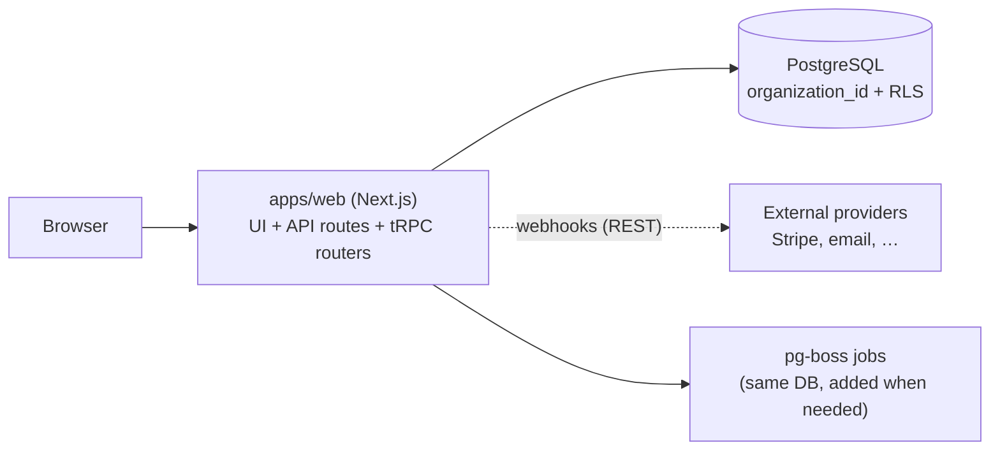

## Topology

One deployable: a fullstack Next.js app that owns its UI, routers, and handlers. The database is
the only stateful component. Background work, when it appears, runs on a Postgres-backed queue —
no extra infrastructure until scale demands it.

## Stack rationale

- **Next.js fullstack monolith** — one repo section, one deploy, one mental model. At this scale
  the bottleneck is iteration speed, not throughput.
- **tRPC over REST internally** — end-to-end types between UI and server with zero contract
  drift; REST is kept only where outsiders call in (webhooks, public API later).
- **Prisma + PostgreSQL** — boring, proven, excellent migrations story. Postgres also covers
  queueing (pg-boss) and full-text search early on, deferring Redis/Elasticsearch.
- **Row-level multi-tenancy** — `organization_id` on every tenant table + RLS policies. Cheapest
  isolation model that still has a defensible security story; schema-per-tenant is an exit path,
  not a starting point.
- **Auth.js** — OAuth providers + sessions without an external auth vendor bill; swap for a vendor
  (Clerk/Auth0) only if enterprise SSO becomes a sales blocker.

## platform/ mapping

- `apps/web` — the Next.js app: pages, feature components, tRPC routers, API routes, webhooks.
- `core/contracts` — Zod schemas + types per domain (`contracts/auth`, `contracts/billing`).
- `core/ui-components` — design tokens + primitives (Button, Input, Modal); feature components
  stay in `apps/web`.
- `data` — Prisma schema, migrations, client, seed scripts.
- `services/` stays empty until a split trigger fires (see exit path).

## ADR seeds

### monolith-first

**Status:** Proposed

**Context:** Early-stage product, small team, requirements still moving. Operational complexity is
the biggest threat to iteration speed.

**Decision:** Build as a single deployable Next.js application. No separate services until a
platform-layout split trigger fires (own deploy lifecycle, dedicated team, different stack, or CI
drag — two or more).

**Alternatives Considered:**
1. Microservices from day one — rejected: operational overhead and contract churn with no scale to justify it.
2. Separate API + SPA — rejected: two deploys and a CORS/auth seam without a consumer that needs the standalone API.

**Consequences:**
- Positive: one deploy, one log stream, trivial local dev; refactors stay in-process.
- Negative: all code shares one runtime and release cadence.
- Risks: module boundaries erode without discipline — mitigated by platform-layout import rules.

### postgres-rls-multitenancy

**Status:** Proposed

**Context:** Multiple customer organizations share one application and one database.

**Decision:** Row-level multi-tenancy: every tenant-scoped table carries `organization_id`;
PostgreSQL RLS policies enforce isolation; the app sets the tenant context per request.

**Alternatives Considered:**
1. Schema-per-tenant — rejected for now: migration fan-out and connection overhead before it's needed.
2. Database-per-tenant — rejected: operational cost only justified by compliance demands.

**Consequences:**
- Positive: one schema to migrate; isolation enforced below the app layer.
- Negative: every query must be tenant-aware; RLS policies need tests.
- Risks: a missing policy leaks data — mitigated by deny-by-default RLS and an isolation test suite.

### trpc-internal-api

**Status:** Proposed

**Context:** UI and server live in the same TypeScript codebase; contract drift between them is
pure waste.

**Decision:** tRPC for all internal client↔server calls. Plain REST routes only for inbound
webhooks and any future public API.

**Alternatives Considered:**
1. REST + OpenAPI codegen — rejected internally: a generation step to maintain for no consumer who needs it.
2. GraphQL — rejected: schema/resolver overhead without multiple diverse clients.

**Consequences:**
- Positive: end-to-end types, instant refactors, no API docs to keep honest internally.
- Negative: public consumers can't use tRPC — a public API is a separate, deliberate surface.
- Risks: tight coupling of client and server types is the point — but makes extracting a separate frontend team's repo harder later.

## Trade-offs accepted

- Single release cadence for everything — a UI typo fix ships with backend changes.
- Vendor-shaped hosting (Vercel) trades cost-at-scale for zero ops today.
- tRPC locks the internal API to TypeScript consumers.

## Scale-out / exit path

| Threshold | Change |
|---|---|
| 10k–100k users | Read replica; move heavy jobs from pg-boss to a dedicated worker (`worker-container-jobs` in `services/`) |
| 100k–1M | Connection pooling (PgBouncer), CDN on all static/asset routes, extract hot paths into `services/` per the split triggers |
| Public API demanded | Add a versioned REST surface (`api-container-public`) — don't expose tRPC |

## Reference deployment

- **Envs:** preview-per-PR (Vercel), `staging`, `production`.
- **CI:** lint + type-check + unit tests on PR; migrations applied on deploy with a rollback plan.
- **Cost ballpark:** $0–50/mo pre-launch; $100–400/mo at early production load.

## Confirm per product

- [ ] Tenancy model confirmed: is the customer an organization (B2B) or an individual (B2C)?
- [ ] Auth providers required (Google? Microsoft? email/password? enterprise SSO later?)
- [ ] Payment provider and billing model (Stripe subscriptions? usage-based?)
- [ ] Hosting region / data-residency constraints (`business/02-legal-org.md`)
- [ ] File/object storage needs (S3-compatible bucket if users upload anything)
- [ ] Email provider for transactional mail
