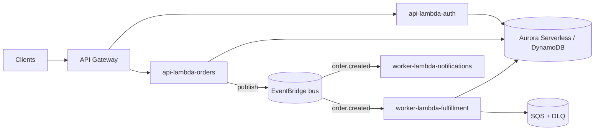

## Topology

Synchronous edges are thin API Lambdas; everything that can be async is: services publish domain
events to EventBridge, worker Lambdas consume via SQS (with dead-letter queues). State lives in
the database and the event log, not in compute.

## Stack rationale

- **Lambda per domain service** — each `services/` unit deploys independently, scales to zero,
  and is named so you can read the architecture from the folder list.
- **EventBridge for domain events** — producers don't know consumers; adding a new reaction to
  `order.created` is a new worker, not a change to the order service.
- **SQS in front of workers** — buffering, retries, and DLQs come from the platform instead of
  hand-rolled code.
- **Aurora Serverless vs DynamoDB** — relational by default; DynamoDB only when access patterns
  are known, stable, and key-shaped. This choice is one of the seeded ADRs to confirm.
- **IaC mandatory** (`platform/infra`) — a serverless topology has too many moving parts to
  click together in a console.

## platform/ mapping

- `services/api-lambda-{domain}` — synchronous edges (routers/handlers inside each service).
- `services/worker-lambda-{domain}` — event/queue consumers.
- `core/contracts` — **event schemas are contracts**: every EventBridge event type is a Zod
  schema here; producers and consumers both import it.
- `core/server` — Lambda handler wrapper, env loader, structured logging, middleware.
- `core/adapters` — capabilities behind interfaces (email, payments) so workers stay testable.
- `data` — migrations + client; `infra` — CDK/Terraform stacks per service.

## ADR seeds

### event-driven-serverless-core

**Status:** Proposed

**Context:** Workload is async-heavy and/or spiky; paying for idle servers and hand-rolling retry
logic are both waste.

**Decision:** Serverless event-driven core on AWS: API Gateway + Lambda for synchronous edges,
EventBridge + SQS + worker Lambdas for everything asynchronous, IaC for all of it.

**Alternatives Considered:**
1. Always-on containers (ECS/Fargate) — rejected at this stage: idle cost and capacity management without a steady-load profile to justify them.
2. Monolith with an internal queue — rejected: the domains' load profiles differ too much to share one runtime. (If they don't — use `modular-monolith-saas` instead.)

**Consequences:**
- Positive: near-zero idle cost; per-domain scaling and deploys; platform-managed retries/DLQs.
- Negative: distributed system from day one — tracing, idempotency, and eventual consistency are now your problems.
- Risks: Lambda cold starts on latency-sensitive paths; vendor lock-in to AWS event plumbing.

### one-lambda-service-per-domain

**Status:** Proposed

**Context:** Function sprawl (one Lambda per endpoint) and a Lambda monolith are both failure
modes; the unit of deployment needs a principled size.

**Decision:** One deployable service per **domain** (`api-lambda-auth`, `worker-lambda-billing`),
each owning its handlers and business rules internally, per platform-layout naming.

**Alternatives Considered:**
1. Lambda-per-endpoint — rejected: hundreds of functions, shared-nothing chaos, IaC sprawl.
2. Single "fat Lambda" router — rejected: recreates the monolith with worse cold starts and no independent scaling.

**Consequences:**
- Positive: deploy units match team ownership and the platform-layout `services/` rule.
- Negative: domain boundaries must be drawn early; wrong cuts mean cross-service chatter.
- Risks: shared logic temptation — must go through `core/contracts`/`core/adapters`, never service-to-service imports.

### eventbridge-domain-events

**Status:** Proposed

**Context:** Multiple services must react to the same business fact without coupling to its
producer.

**Decision:** Domain events on an EventBridge bus, schema'd in `core/contracts`, versioned
additively (new fields optional; breaking changes are a new event version). Consumers attach via
SQS with DLQs; all handlers are idempotent.

**Alternatives Considered:**
1. Direct service-to-service invocation — rejected: synchronous coupling and retry storms.
2. A self-managed Kafka — rejected at this scale: operational cost dwarfs the benefit.

**Consequences:**
- Positive: producers and consumers evolve independently; the event log doubles as an audit trail.
- Negative: eventual consistency surfaces in UX and must be designed for.
- Risks: schema drift — mitigated by contracts-as-code in `core/contracts`.

## Trade-offs accepted

- Distributed-system complexity (tracing, idempotency, partial failure) in exchange for elasticity
  and idle-cost ≈ 0.
- AWS lock-in at the orchestration layer (EventBridge, SQS, Step Functions).
- Local development requires emulation/stubs (`core/adapters` keeps domain logic testable offline).

## Scale-out / exit path

| Signal | Change |
|---|---|
| Steady high baseline load on a service | Move that service to Fargate/containers — per-request pricing loses above sustained load |
| Cold starts hurting a sync path | Provisioned concurrency on that Lambda, or extract to a container |
| Event volume → analytics needs | Add a firehose consumer to a warehouse; don't query the OLTP store |

## Reference deployment

- **Envs:** `dev` (ephemeral stacks per branch where possible), `staging`, `production` — separate
  AWS accounts.
- **CI:** synth/plan on PR, deploy on merge; contract tests on `core/contracts` schemas gate
  producer deploys.
- **Cost ballpark:** near $0 idle; usage-driven thereafter (budget alarms in `infra` from day one).

## Confirm per product

- [ ] Aurora Serverless (relational) vs DynamoDB (key-value) — per actual access patterns
- [ ] Which paths are genuinely synchronous (and thus latency-budgeted)?
- [ ] Auth: Cognito vs custom JWT authorizer
- [ ] CDK or Terraform (team preference / existing estate)
- [ ] Multi-account strategy and who owns AWS billing
- [ ] Observability stack (CloudWatch alone vs Datadog/Honeycomb)
