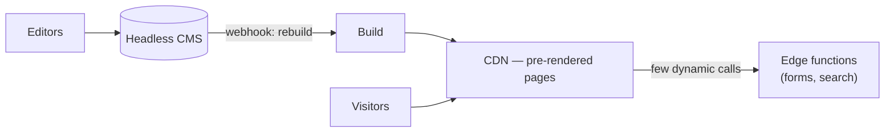

## Topology

Everything a visitor sees is pre-rendered at build time and served from a CDN. Content edits in
the CMS trigger a rebuild. The only running code is a handful of edge functions for forms, search,
or payment redirects.

## Stack rationale

- **Static-first** — pre-rendered HTML is the fastest, cheapest, most SEO-friendly delivery there
  is; there are no servers to patch or scale.
- **Astro by default** — content-first framework, zero JS shipped unless an island needs it;
  choose Next.js static export instead when the team already lives in Next or a later pivot to an
  app is likely.
- **Headless CMS** — editors work without touching the repo; the site rebuilds on publish. For
  developer-authored content, markdown in the repo is the even simpler answer.
- **No database** — state is a liability here. A contact form posts to an edge function that
  forwards to email/CRM.

## platform/ mapping

- `apps/site` — the static site (pages, content collections, islands) and its edge functions
  (they're the app's own handlers, not separate services).
- `core/ui-components` — design tokens + primitives if a future app will share the brand;
  otherwise components stay in `apps/site` until a second app exists.
- `core/contracts` — schemas for CMS content types and form payloads.
- `services/`, `data/` — empty; their first real tenant usually means graduating archetypes.

## ADR seeds

### static-first-rendering

**Status:** Proposed

**Context:** The product is content the public reads; SEO and load speed matter; the team wants
zero operational surface.

**Decision:** Pre-render all pages at build time; serve from CDN; use islands/edge functions only
where interactivity is genuinely needed. Content changes deploy via rebuild, not runtime fetches.

**Alternatives Considered:**
1. Server-rendered app (SSR) — rejected: a running server and its costs for pages that change only on publish.
2. WordPress/site-builder — rejected: hosting/plugin maintenance, and the design ceiling conflicts with a code-owned brand.

**Consequences:**
- Positive: effectively infinite read scaling, trivial rollbacks (redeploy previous build), near-zero cost.
- Negative: content freshness is gated by build time; very large sites need incremental builds.
- Risks: dynamic-feature creep erodes the model — each new function should be questioned.

### headless-cms-content

**Status:** Proposed

**Context:** Non-developers must edit content without a developer in the loop.

**Decision:** Content lives in a headless CMS; publish webhooks trigger site rebuilds. Content
types are schema'd in `core/contracts`.

**Alternatives Considered:**
1. Markdown in the repo — right answer when only developers write; rejected as the default because editors were specified.
2. Database + admin panel — rejected: that's building a CMS.

**Consequences:**
- Positive: editorial autonomy; clean content/presentation split.
- Negative: a SaaS dependency and its pricing tier; content previews need wiring.
- Risks: CMS lock-in — mitigated by keeping content models portable and schema'd in contracts.

## Trade-offs accepted

- Publish-to-live latency = build time.
- Not a path to a logged-in product — that's a different archetype, by design.
- CMS subscription cost in exchange for editorial independence.

## Scale-out / exit path

| Signal | Change |
|---|---|
| Builds exceed ~5 min | Incremental builds / on-demand ISR |
| A logged-in area becomes the product | Don't bolt it on — apply `modular-monolith-saas` for the app; keep this site as `apps/site` beside it |
| Search outgrows static indexes | Hosted search (Algolia/Typesense) fed at build time |

## Reference deployment

- **Envs:** preview-per-PR + production (host-provided).
- **CI:** build + link-check + Lighthouse budget on PR.
- **Cost ballpark:** $0–20/mo + CMS tier.

## Confirm per product

- [ ] Who edits content — developers (markdown in repo) or editors (CMS, which one)?
- [ ] Astro vs Next.js static export (team familiarity, future-app likelihood)
- [ ] Which interactions truly need functions (forms? search? checkout?)
- [ ] Analytics + consent requirements (`business/02-legal-org.md`)
- [ ] i18n / multi-language needs
